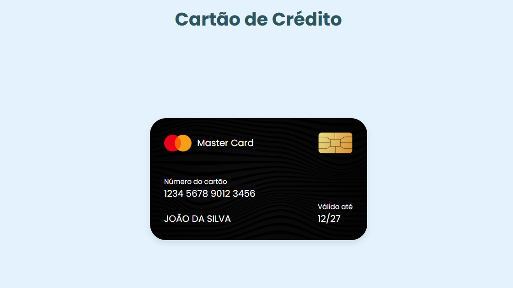

# 💳 Design de Cartão de Crédito

Projeto de uma interface visual de cartão de crédito, desenvolvido com **HTML5 e CSS3** como parte de uma atividade prática do curso PROA.

O projeto tem como objetivo explorar conceitos de estilização e organização de elementos, recriando a aparência de um cartão de crédito com detalhes visuais que simulam um modelo físico.

## 🖥️ Prévia do projeto

  

🔗 **[Acesse o projeto online](https://gabrielc0liveira.github.io/Projeto17Proa-DesigndeCartao/)**

## Funcionalidades e características

- Representação visual de um cartão de crédito.
- Interface com fundo escuro e textura personalizada.
- Logotipo da bandeira e chip ilustrativo.
- Exibição de número, nome do titular e validade fictícios.
- Organização dos elementos com Flexbox.
- Bordas arredondadas e efeitos de sombra.
- Tipografia personalizada.
- Layout desenvolvido exclusivamente com HTML e CSS, sem JavaScript.

## Tecnologias utilizadas

- **HTML5:** estruturação do cartão e organização de suas informações.
- **CSS3:** estilização, posicionamento, cores, sombras e composição visual.
- **Google Fonts:** utilização da fonte Poppins.

## Aprendizados

Durante o desenvolvimento, foram praticados conceitos como:

- Estruturação de componentes visuais com HTML.
- Organização de elementos utilizando `display: flex`.
- Alinhamento com `align-items` e `justify-content`.
- Utilização de `flex-direction: column`.
- Aplicação de imagens com `background-image`.
- Ajuste de imagens utilizando `background-size: cover`.
- Criação de bordas arredondadas com `border-radius`.
- Aplicação de sombras utilizando `box-shadow`.
- Controle de espaçamentos com `margin` e `padding`.
- Personalização da tipografia com `font-size`, `font-weight` e `letter-spacing`.
- Utilização de `max-width` para limitar a largura dos componentes.
- Organização de informações em diferentes áreas de um cartão.

## 📂 Como executar o projeto

🔗 **[Acesse o projeto online](https://gabrielc0liveira.github.io/Projeto17Proa-DesigndeCartao/)**

---

Desenvolvido por **Gabriel Oliveira** como parte das atividades práticas do PROA.
